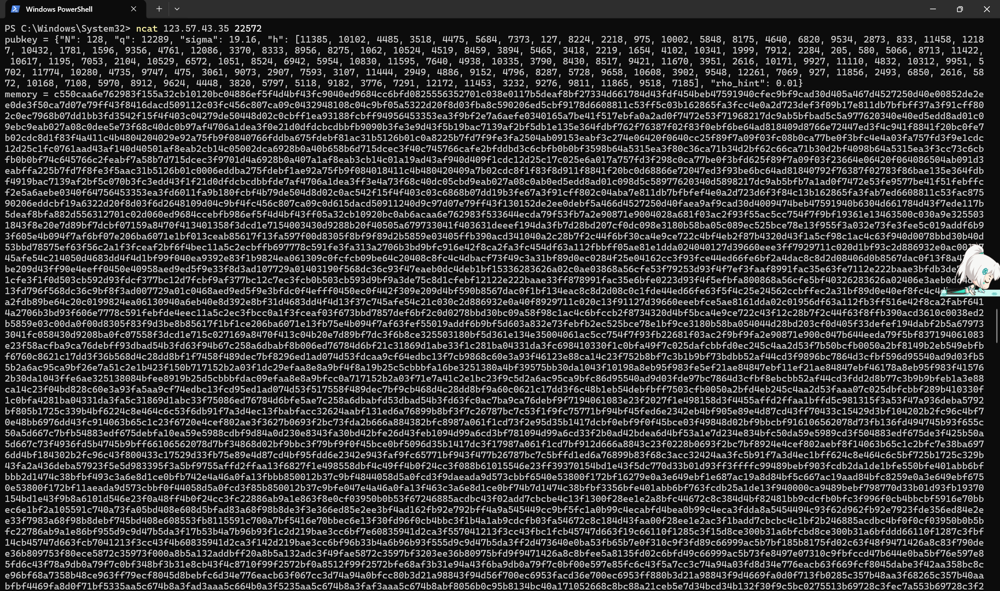
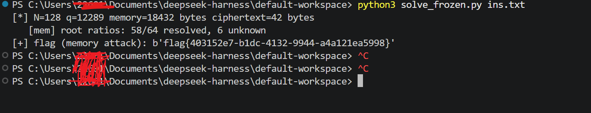
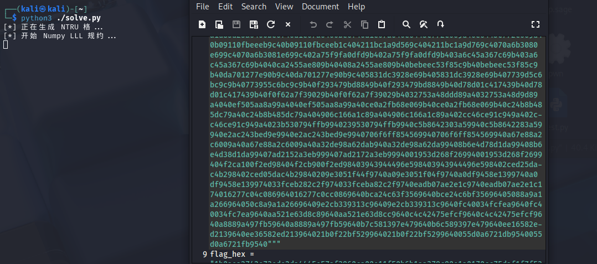

# frozen —— 从"冷启动"的 Falcon 内存里抠出 flag

> 题目类型：Crypto / 格密码逆向
> 关键词：Falcon、NTRU、LDL 树、冷启动攻击（Cold Boot）、鲁棒最小二乘
> 附件：`task.py`
> 最终 flag：`flag{403152e7-b1dc-4132-9944-a4a121ea5998}`

---

## 0x00 题目给了什么

题目是一个**远程 nc 服务**：连上去之后，服务端现场生成一组密钥，把三行 hint 打回来。

```text
pubkey = {"N": 128, "q": 12289, "sigma": 19.16, "h": [...], "rho_hint": 0.01}
memory = <18432 字节的十六进制>
flag   = <42 字节密文的十六进制>
```



`pubkey` 里有 `h`（NTRU 公钥）；`memory` 是"被冻坏的内存快照"；`flag` 是密文。
附件 `task.py` 是这个服务的生成逻辑（`from secret import flag`），flag 本身不在附件里。

注意 `seed = sysrng.randrange(1, 2 ** 62)`：**每次连接都是全新的一组密钥**，
所以三行必须取自**同一次连接**的回显——把它原样存成 `ins.txt` 再本地解。

---

## 0x01 先读懂 task.py

把无关的样板去掉，题目只做了一件事：

```python
key, cblob, D = try_instance(seed, dseed, RHO10)   # 生成 Falcon 私钥 + 泄漏内存
canon = ",".join(str(c) for c in D).encode()
fk = hashlib.sha256(b"frozen:" + canon).digest()
ct = bytes(a ^ b for a, b in zip(flag, keystream(fk, len(flag))))
```

也就是说：

* **密钥 = `D`**，而 `D` 的定义只有一行：

  ```python
  ff = poly_mul(f, poly_adj(f, N), N)      # f · f*
  gg = poly_mul(g, poly_adj(g, N), N)      # g · g*
  D  = [a + b for a, b in zip(ff, gg)]     # D = f·f* + g·g*
  ```

  其中 `f, g` 是 Falcon 私钥里那两个很短的高斯多项式（`sigma = 19.16`）。
* 加密就是一个 SHA-256 计数器流异或，只要能算出 `D`，就直接 `sha256("frozen:" + D)` 出密钥。

所以题目的本质可以一句话概括：**从被位翻转污染的内存快照里还原整数多项式 `D`。**

### 内存里到底存了什么

`expanded_doubles(key)` 把这些 double 塞进 blob：

| 偏移 | 内容 | 是否被丢掉 |
|---|---|---|
| 前 `8N = 1024` 个 double | `f, g, F, G` 在 2N 次单位根上的 FFT 实部/虚部 | 是，`cblob_full[head*8:]` 全部丢掉 |
| 接着 `2N` 个 double | `Ltop = G01 / G00`（N 个复数） | 保留 |
| 接着 `N·log2(N)` 个 double | `T(G00)` 子树的内部节点（N 个复数） | 保留 |
| 接着 `N·log2(N)` 个 double | `T(Dright)` 子树的内部节点 | 保留 |
| 最后 `2N` 个 double | 两棵子树的叶子（实数） | 保留 |

所以 `memory` 只有 **18432 字节 = 2304 个 double**，`f, g` 的 FFT 值一点都没剩，只剩下一棵"树"。

### 污染模型（冷启动）

```python
def corrupt_blob(blob, rho10, rho01=0.0, rng=None):
    for di in range(len(blob)//8):
        for bit in list(range(56)) + [63]:      # 低 56 位 + 符号位
            if (x >> bit) & 1:
                if rng.random() < 0.01:  x ^= 1 << bit     # 1 -> 0：1%
            elif rng.random() < 0.001:
                x ^= 1 << bit                              # 0 -> 1：0.1%
```

典型的冷启动衰减：**每个 double 的每个为 1 的位有 1% 概率翻掉**。
注意它翻的是 **0~55 位**，包括指数域的低 4 位（52~55 位），所以偶尔会把一个值直接放大/缩小 2、4、8、16 倍。

---

## 0x02 数学准备：这棵树为什么能还原 `D`

### 2.1 负循环环与 FFT

所有运算都在 `Z[x]/(x^N+1)` 里（`N = 128`，`q = 12289`）。取 `ρ_j = exp(iπ(2j+1)/N)`，它是 2N 次单位根，且 `ρ_j^N = -1`。定义

```python
def fft(a):
    M = np.exp(1j*np.pi*np.outer(np.arange(n), 2*np.arange(n)+1)/n)
    return a @ M          # F[j] = a(ρ_j)
```

逆变换是 `a = real(conj(M) @ F) / N`（注意是 `conj(M) @ F`，不是 `conj(M).T @ F`，这里我第一次写错过）。

题目里的 `poly_adj` 其实就是 **`a(x⁻¹)`**：

```python
def poly_adj(a, N):
    return [a[0]] + [-a[N-i] for i in range(1, N)]     # x^(-i) = -x^(N-i)
```

所以

```text
D(x) = f(x)f(x⁻¹) + g(x)g(x⁻¹)
V_j  = D(ρ_j) = |f(ρ_j)|² + |g(ρ_j)|²  > 0
```

`V = (V_0..V_{N-1})` 是实数向量，`D = IFFT(V)` 是整数向量 —— **整数性就是天然的校验**。

### 2.2 LDL 树

`falcon_tree` 构造的是 Gram 矩阵的 LDL* 分解：

```text
G00 = |g|² + |f|²                  ( = D )
G01 = g·conj(G) + f·conj(F)
G11 = |G|² + |F|²
Ltop   = G01 / G00
Dright = G11 - |Ltop|²·G00
tree   = [Ltop, T(G00), T(Dright)]
```

而 `_T(E)` 递归地把数组切成两半：

```text
Ee = (E[:h] + E[h:]) / 2
Eo = (E[:h] - E[h:]) / (2ρ)
L  = conj(Eo) / Ee           ->   L = s·ρ  (s 是实数!)
子节点： T(Ee),  T(Ee·(1-s²))
```

所以每个节点存的 `L` 满足 `L = s·ρ_j`，并且该节点的隐含约束是

```text
E_left / E_right = (1+s)/(1-s)
```

### 2.3 一个决定性的恒等式

`fG - gF = q`（NTRU 方程），所以 Gram 矩阵的行列式处处等于 `q²`：

```text
G00·G11 - |G01|² = q²     ⇒     Dright = q² / G00
```

这一行是整个题目的支点：**第二棵子树 `T(Dright)` 也是 `V` 的函数**，于是数据量直接翻倍（896 个比值观测 + 256 个叶子）。

---

## 0x03 直接照着树往下算？不行

最朴素的做法是：从 `L` 里取出 `s`，按 `Ee`、`Ee(1-s²)` 一层层往下重建 `V`。我一开始就是这么写的，结果

```text
clean   rel err max 1.26e-13      ->  D 完全正确
corrupt rel err max 1.0           ->  D 全错
```

原因有两个：

1. **误差会乘性放大**：每层都乘以 `(1-s²)`，7 层下来，一个 50% 的错误就被放大到面目全非；
2. **`1-s²` 的精度问题**：一旦某个 `s` 被翻坏成 `|s| > 1`，`1-s²` 直接变号，整棵子树全废。

更隐蔽的是：`s` 是**逐下标**的，所以祖先节点的 `s` 坏掉会变成子树的"逐下标缩放"，在比值里**不能约掉**。这就是为什么"用观测到的 `s` 构造线性方程组"这条路（我试过两种：`V` 空间齐次最小二乘、`log` 空间带偏移的稀疏差分）都会失败——实测约 30%~50% 的行被污染。

> 踩坑结论：**不要用被污染的 `s` 去传播线性映射**。正确做法是让模型自己从候选 `V` 重算整棵树（自洽前向模型），这样某个 double 坏掉只影响它自己那一行的残差。

---

## 0x04 正确姿势：把 `log V` 当未知量

未知量：`y = log V ∈ R^N`（`N = 128`）。
观测量：

* 每个节点给出的 `log E_left - log E_right = log((1+s)/(1-s))`（两棵树共 896 条）
* 每个叶子给出的 `log E_leaf`（共 256 条）

前向模型 `forward(y)` 就是照抄 `_T` 的递归，只是 `s` 由候选 `V` 自己算出：

```python
def tree(E):
    if E.shape[1] == 1:                     # 叶子
        lf.append(np.log(E[:, 0:1])); return
    El, Er = E[:, :h], E[:, h:]
    s = (El - Er) / (El + Er)
    lr.append(np.log1p(s) - np.log1p(-s))   # 这个节点的比值
    Me = 0.5 * (El + Er)
    tree(Me); tree(Me * (1 - s*s))

tree(V); tree(q*q / V)                      # 两棵子树
```

然后做**带 Huber 权重的 Gauss-Newton，`delta` 从 3.0 一路退火到 1e-5**（雅可比用批量有限差分：一次前向批 129 个样本，`N=128` 维，全部 numpy 向量化，整轮只要几秒）。

到这一步，`y` 的中位误差已经到 `1e-13` 量级，`V` 的"平均部分"完全正确，`D` 的偶下标系数也全对 —— 但 **`D` 的奇下标系数全错**。

---

## 0x05 两个关键发现

### 5.1 树对"根对交换"完全不敏感

把 `V_j` 和 `V_{j+N/2}` 交换，会发生什么？

* 根节点比值：`r_j → 1/r_j`（变了）；
* level-1 的数组是 **算术平均** `(V_j + V_{j+N/2})/2` —— **不变**；
* 于是 `(1-s²)` 也不变（`s → -s`，平方不变），更深的数组、叶子全都不变。

也就是说：

> 每个根对 `(j, j+N/2)` 的交换只会改变**它自己那一行**，树的其余部分对它是"瞎的"。
> 结论：`D` 的奇数部分只由 **64 个根比值**决定。

这就解释了为什么拟合结果"中位误差 1e-13，但奇系数全错"——错的那几对根比值，深层数据根本管不到。

### 5.2 相位检测器：100% 准确的"哪份测量被翻坏了"

每个根比值其实有**两份**测量：`T(G00)` 的根给 `t`，`T(Dright)` 的根给 `-t`（因为 `Dright = q²/V`）。

而正常节点的 `L` 必须严格满足 `L = s·ρ`，即

```python
Im(L * conj(rho)) == 0        # 相位残差
```

只要有任意一位被翻坏，这个虚部就不再是 0。实测（8 个同参数的自造实例）：

```text
被判为"干净"的测量 -> 100% 是精确值（clean & accurate = 100%）
被判为"脏"的测量   -> 直接丢掉的代价只是把那一对标记为 unknown
```

于是每个根对的处理变成：

1. 两份测量里挑相位干净的那份 -> 绝大多数（58/64）直接精确拿到；
2. 两份都脏的少数几对（实测 5~11 对）-> 交给 0x06。

---

## 0x06 收尾：整数性 + 可打印性

对于剩下的 unknown 对，用两个全局判据兜底：

1. **整数性**：`IFFT(V)` 必须是整数向量，代价函数
   `penalty = Σ (D_k - round(D_k))²`；对不确定的对做坐标下降 + 局部细扫；
2. **解密可打印性**：最终的 `D` 解密出来必须是可打印 ASCII。
   42 字节全落在 `[0x20,0x7f)` 的概率是 `(95/256)^42 ≈ 1e-18`，是一个极强的最终裁判。

把"最没把握的 16 对"做 2^16 枚举、每种组合都试一次解密，2 秒内跑完。

---

## 0x07 运行

```bash
pip install numpy
python3 solve_frozen.py ins.txt
```

`ins.txt` 就是 nc 那次回显的三行原文。实际运行：

```text
[*] N=128 q=12289 memory=18432 bytes ciphertext=42 bytes
   [mem] root ratios: 58/64 resolved, 6 unknown
[+] flag (memory attack): b'flag{403152e7-b1dc-4132-9944-a4a121ea5998}'
```



脚本在 Win11 和 Kali 上都能直接跑（只依赖 numpy）；把 nc 的回显直接存文件喂进去即可，不用手抄任何东西。

[脚本使用指南](../frozen_WP/README.md)

---

## 0x08 备用路线：直接打公钥

万一内存那条路没走通，还有一条纯格的路：`h = g/f mod q`，所以

```text
(f, g) ∈ L = { (u, v) : u·h ≡ v (mod q) }
```

基为 `[[I, H], [0, qI]]`（`2N = 256` 维，`H` 是 `h` 的负循环乘法矩阵）。
`(f,g)` 的范数 `≈ σ√(2N) = 306`，而该格的高斯启发值 `≈ 3.87·√q = 429`，
`306/429 = 0.71` —— 明显短于随机格，LLL/BKZ 有机会捞出来。

捞出来之后有两个坑：

1. **`D` 对旋转和取负其实是不变的**（这个我一开始也判断错了）：
   `D(x^k f) = x^k f · x^{-k} f* = f·f*`，所以 `x^k(f,g)`、`-(f,g)` 给出的 `D` 完全相同，
   不需要做旋转枚举；
2. **但格里的另一族 `(F,G)` 会给出完全不同的 `D`**：因为 `fG - gF = q ≡ 0 (mod q)`，
   所以 `(F,G)` 同样在格中（实测 `‖(F,G)‖ = 943`，而 `‖(f,g)‖ = 305`），
   它给出的 `D' = F·F* + G·G*` 其实是 `G11` 而不是 `G00`，两者系数最大差到 **80 万**。
   所以必须**把两族都试一遍**，或者只认范数最小的那几个向量。

脚本里已经内置了这条路（`lattice_attack`，需要 `pip install fpylll cysignals`），内存攻击失败会自动接管。

---

## 0x09 附：第一天那份"纯 LLL"脚本错在哪

第一版思路是：构造 NTRU 格 -> 纯 numpy 写个 LLL -> 找 `(f,g)` -> 旋转爆破 -> 解密。
思路方向没错，但有几处硬伤，正好可以当作反面教材。



上图就是当时的现场：格基生成完，刚打印到 `开始 Numpy LLL 规约 ...` 就卡死在那儿，等到放弃。

### ① 致命：格构造少了负循环的符号（`(f,g)` 根本不在这个格里）

```python
B[i][N + j] = h[(j - i) % N]          # 错在这里
```

`Z[x]/(x^N+1)` 里 `x^N = -1`，所以乘法矩阵的环绕那半边要**取负**：

```python
k = j - i
B[i][N + j] = h[k % N] if k >= 0 else -h[k % N]     # 正确写法
```

少了这个负号，格就变成了"正循环卷积"的格，`(f,g)` 不在里面。实测（N=128、q=12289 的一组真密钥）：

```text
f * h        （负循环，即题目 poly_mul） == g   ->  True
f * H_pos    （脚本里的矩阵）            == g   ->  False
(g - f*H_pos) mod q 的 128 个分量里，非零的有 127 个
=> (f,g) 不在这个格里
```

所以后面 `hf == gc` 的校验**永远不会成立**，循环必然走到"未找到私钥"。
这是"跑了很久但一行结果都没有"的根本原因。

### ② `hf == gc` 这个校验也不能当"找到私钥"的判据

即使格构造正确，**每一条格向量**都满足 `v ≡ u·h (mod q)`，
所以这个等式只能证明"格是对的"，不能证明"拿到的是 `(f,g)`"。
它会把基里第一条向量直接当成私钥返回，而那条很可能是 `(F,G)` 族或它们的组合。
正确做法是：按范数排序取最短的若干条，两族都算 `D` 去解密。

### ③ 纯 LLL + `delta = 0.75`，短向量根本出不来

* `delta` 越小，Lovász 条件越松，基越"不短"。一般至少 `0.99`；
* 更关键的是：`256` 维、`q = 12289` 的 NTRU 格，`(f,g)` 只有高斯启发值的 **0.71 倍**，
  这个差距**不是 LLL 能补的**，需要 BKZ（块大小大概要 40 以上）才稳。
  所以这条路即使把矩阵改对，也大概率跑不出 `(f,g)`。

### ④ 性能：每次操作都全量重算 Gram–Schmidt

```python
def gram_schmidt():          # O(n^3)，n = 256 -> 每次约 1.7e7 次浮点乘加
    ...
...
B[k] -= q_val * B[j]
gram_schmidt()               # 每做一次 size-reduce 就重算一遍
```

LLL 主循环要做成千上万次 size-reduce，等于几万次全量 GS，
在 256 维上要跑几个小时。正确写法是**增量更新** `mu` 和 `B*`（教科书版 LLL），
或者直接用 `fpylll` 的 `LLL.reduction / BKZ.reduction`。

### ⑤ 另外两个小问题

```python
if np.dot(B_star[k], B_star[k]) >= (delta - mu[k,k-1]**2) * ...
```

`B_star[j]` 在浮点下可能接近 0，`mu[i,j] = dot(...)/dot(B_star[j],B_star[j])` 会除零出 `inf/nan`，
整个基就废了，需要加保护或用整数/有理数版本的 LLL。

判断 flag 的方式也太"主观"：

```python
if any(c in decoded for c in ['ctf', 'CTF', 'flag', 'Flag']):
```

随机字节在 `decode('utf-8')` 时大概率直接抛异常，而且万一 flag 里不含这些词就漏了。
用"**42 字节全是可打印 ASCII**"判断更稳（假阳性概率 `(95/256)^42 ≈ 1e-18`）：

```python
if all(32 <= c < 127 for c in pt):
    print(pt)
```

### ⑥ 旋转爆破这一步其实是白做的

前面说过了，`D` 对旋转不变，那 128 次旋转 + 2 次取负全是无用功；
真正需要区分的是 `(f,g)` 与 `(F,G)` 两族。

> **结论**：第一版的问题不在"LLL 写得不够快"，而在
> ①格就是错的（少一个负号）②即使改对，纯 LLL 也够不着 ③判据错了。
> 这也是后来放弃"硬打公钥"、转而从内存树里直接还原 `D` 的原因：
> 树里全是冗余信息，完全不需要做格规约。

---

## 0x0A 总结

这道题最漂亮的地方在于：看起来是"内存泄漏 + 噪声"，实际上噪声只是障眼法，真正的结构是

1. **flag 的密钥不是私钥，而是 `D = f·f* + g·g*`** —— 只要 `D`，不要 `f, g`；
2. **`D` 就是树的根块 `G00`**，而 `G00` 又能通过行列式恒等式 `G00·G11 - |G01|² = q²` 把另一棵子树也变成自己的函数 —— 数据量翻倍；
3. **树对根对交换不敏感**，把 `D` 的奇偶部分拆开，64 个根比值可以独立拿下；
4. **`L = s·ρ` 的相位条件**是一个完美检测器，把"哪份测量坏了"这个二选一直接做成了单选题。

最终只用了 2 秒、纯 numpy，就把 2304 个 double 里 ~500 个被翻坏的位全部绕过，还原出精确的整数多项式 `D`。

回头看，第一天那版"硬打公钥"的脚本之所以卡死，主要是三件事：
**格少了负循环的负号**（`(f,g)` 压根不在格里）、**纯 LLL 够不着 0.71 倍的高斯启发值**、
以及**把 `hf == gc` 当成了"找到私钥"的判据**（它对每条格向量都成立）。
把判据换成"最短向量 + 两族都试 + 可打印性"，再换成内存树攻击，才是这道题的正解。

```text
flag{403152e7-b1dc-4132-9944-a4a121ea5998}
```

---

<!-- 待补充截图：文件名继续用 04.png、05.png ... 放好后把下面的注释去掉即可 -->
<!--  -->
<!--  -->
<!--  -->
<!--  -->
